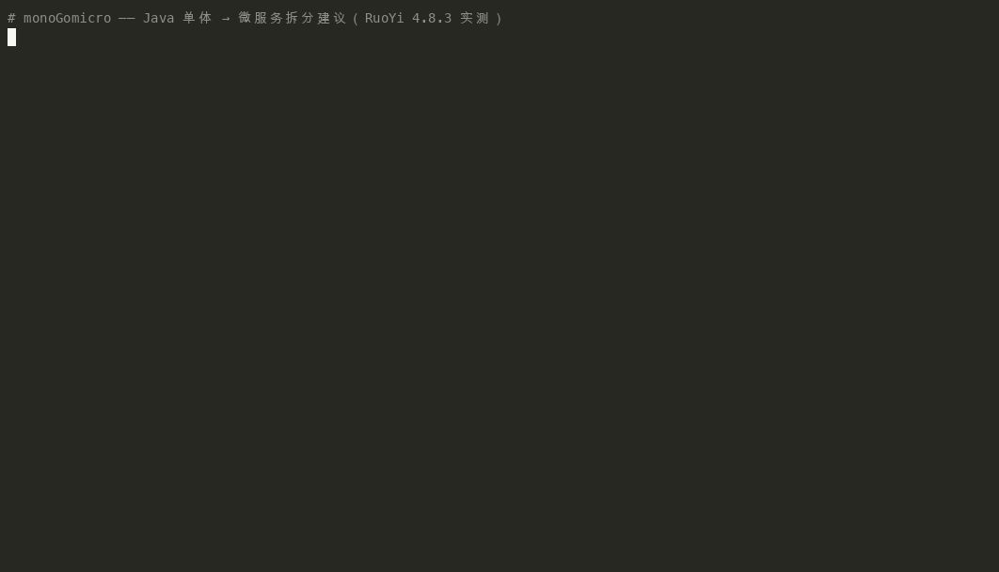

**简体中文** | [English](README.md)

# monoGomicro

[](https://central.sonatype.com/artifact/io.github.iztou/monogomicro-mcp)
[](LICENSE)


Java 单体应用 → 微服务拆分建议工具（IBM Mono2Micro 的开源复刻）。

输入一个 Java/Maven 单体项目，输出：微服务分区建议（可交互编辑）、共享内核识别、
可直接编译的微服务工程骨架（跨服务调用自动改写为 REST）、人工迁移清单。



## 与 IBM Mono2Micro 的对标

| Mono2Micro 能力 | 本项目实现 | 模块 |
|---|---|---|
| 静态分析 | JavaParser 符号解析（源码 + JDK + Maven 依赖 jar），import/泛型参数/字段注解/枚举/@interface/类字面量/varargs 全覆盖 | core |
| 运行时分析 | ByteBuddy java agent 插桩，按 HTTP 入口切分业务用例，重建调用链 | agent |
| AI 分区建议 | 双图融合 + Louvain 社区发现 + 模拟退火多目标优化（通信成本/用例跨度/规模均衡） | core |
| 图形视图与分区编辑 | 本地 Web 控制台：D3 力导向图 + 拖拽调整 + 指标实时重算 | web |
| 代码重构 | 分区 → Maven 多模块微服务工程：跨服务注入改写为 REST 客户端/Controller 桥、共享 DTO 自动提取、内核依赖闭包、MIGRATION.md | codegen |

## 架构

```
monogomicro-core      解析器 / 依赖图 / 分区算法 / 指标 —— 无框架纯库
monogomicro-agent     运行时插桩 agent（ByteBuddy，premain）
monogomicro-codegen   分区 → 微服务工程生成（源码改写）
monogomicro-cli       m2m 命令行（analyze / partition / trace / generate）
monogomicro-web       本地控制台（Spring Boot 薄 REST + D3 单页）
```

## 安装

构件发布在 [Maven Central](https://central.sonatype.com/artifact/io.github.iztou/monogomicro-mcp)（`io.github.iztou`，0.1.0+）：

```bash
# Homebrew（macOS / Linuxbrew）
brew install iztou/tap/m2m        # CLI：m2m analyze / partition / trace / generate
brew install iztou/tap/m2m-mcp    # MCP server（stdio）

# jbang 直跑（免克隆免 package，JDK 也由 jbang 自动供应）
jbang io.github.iztou:monogomicro-cli:0.2.0 analyze /path/to/monolith -p com.your.pkg -o m2m-out
```

```xml
<!-- 或作为 Maven 依赖（core 无框架纯库，可直接嵌入） -->
<dependency>
    <groupId>io.github.iztou</groupId>
    <artifactId>monogomicro-core</artifactId>
    <version>0.2.0</version>
</dependency>
```

从源码构建见下方快速开始。

## 快速开始

```bash
mvn -DskipTests package

# 1. 静态分析（自动解析 Maven classpath）
java -jar monogomicro-cli/target/m2m.jar analyze /path/to/monolith -p com.your.pkg -o m2m-out

# 2. 分区建议（可选融合运行时轨迹）
java -jar monogomicro-cli/target/m2m.jar partition -a m2m-out/analysis.json -o m2m-out

# 3.（可选）运行时采集：启动你的应用
java -javaagent:monogomicro-agent/target/monogomicro-agent-0.3.0.jar=\
out=/tmp/trace.log,include=com.your.pkg.,entry=DispatcherServlet -jar app.jar
#    然后带轨迹重新分区：
java -jar monogomicro-cli/target/m2m.jar partition -a m2m-out/analysis.json -t /tmp/trace.log -o m2m-out

# 4. 生成微服务工程（输出目录可 mvn compile）
java -jar monogomicro-cli/target/m2m.jar generate \
  -a m2m-out/analysis.json -p m2m-out/partition.json \
  --project /path/to/monolith -o m2m-out/services

# 5.（可选）可视化控制台：http://localhost:8080
java -jar monogomicro-web/target/monogomicro-web.jar
```

## MCP 模式（LLM 在环）

`monogomicro-mcp` 把流水线暴露为 [MCP](https://modelcontextprotocol.io) server，
默认 stdio 传输，Claude Desktop / 任意 MCP 客户端可对话式完成「分析 → 摘要 → 追问归属依据 →
移动类看指标变化 → 撤销」：

```json
// Claude Desktop -> Settings -> Developer -> Edit Config (claude_desktop_config.json)
{
  "mcpServers": {
    "monogomicro": {
      "command": "java",
      "args": ["-jar", "/绝对路径/monogomicro-mcp/target/m2m-mcp.jar"]
    }
  }
}
```

团队内网共享可用 HTTP 传输（Streamable HTTP，多客户端共享同一工作区状态）：

```bash
java -jar monogomicro-mcp/target/m2m-mcp.jar --http --port 8082   # 默认 127.0.0.1，POST /mcp
# 客户端配置 type: "http" + url: http://127.0.0.1:8082/mcp
```

注意：Host 头白名单（防 DNS rebinding）只放行绑定地址与 loopback——内网共享须
`--host <本机内网 IP>` 显式绑定（如 `--host 192.168.1.10`）；绑 `0.0.0.0` 反而会让
内网客户端因 Host 头不匹配被 403 拒绝。

工具一览（17 个）：`analyze_project` / `load_workspace` / `ingest_trace` / `compute_partition` /
`generate_services`（默认 dry-run）/ `save_partition`（流水线）；`get_partition_summary` /
`list_classes` / `get_class_info` / `find_classes` / `get_metrics` / `get_migration_items`
（观察，渐进式披露，单工具返回 ≤4KB）；`move_class`（返回指标 delta）/ `rename_service` /
`undo`（编辑）；`audit_architecture` / `suggest_refactoring`（架构体检，只读）。另有资源 `m2m://analysis`、`m2m://partition` 供客户端按需拉取大对象。
错误统一结构化（`{code, message, hint}`，拼错类名/服务 id 附相近候选）；写路径限制在 workspace 根内；
`analyze_project` 支持进度通知（客户端传 `_meta.progressToken` 即每 50 个源文件收到进度）。
设计文档见 `docs/mcp-design.md`；契约测试（真子进程 stdio + HTTP 两条传输的 JSON-RPC 全链路）随 `mvn verify` 运行。

调试与体验：用官方 Inspector 图形化调用全部工具——

```bash
npx @modelcontextprotocol/inspector java -jar monogomicro-mcp/target/m2m-mcp.jar
# 打开提示的 URL：左侧 Tools 列表逐个试；Resources 页看 m2m://analysis
```

一段真实对话（RuoYi，Claude Desktop）：

> **我**：帮我看看这个单体怎么拆
> **AI**：`load_workspace` 载入分析结果…12 个服务，模度 0.55，跨服务通信占比 19.9%，
>         共享内核 7 个类。`get_partition_summary` 摘要如下：job-service(16) / file-service(12) / …
> **我**：SysUserServiceImpl 为什么在 user-service？
> **AI**：`get_class_info` → SERVICE_IMPL，25 条出边中 8 条连接 user-service 的类
>         （`neighborConcentration`），最强依赖 SysUserMapper(weight 12) 同服务。
> **我**：把它移到 job-service 试试
> **AI**：`move_class` → crossRatio 0.1994 → **0.2134**，modularity 0.5476 → **0.5379**（两项均变差）。
>         建议撤销：`undo` 已恢复，指标回落。

## 架构体检（面向已有微服务）

> 需要 **0.3.0**（撰稿时 Maven Central / Homebrew 尚未发布，渠道上是 0.2.0）——请从源码构建使用。

`m2m audit` 体检一个**已经是微服务**的工程（Maven 多模块 monorepo）。服务边界默认按
Maven module 自动推导（可选 `services.json` 修正）；报告含指标——**边界耦合率**
（编译期依赖语义，剔除 shared 库）、模度、每服务扇入/扇出——与六类反模式检测：
服务级循环依赖（Tarjan SCC）、上帝服务、该合并对、哑服务、共享库滥用、归属错位类
（继承错位升为 critical）。

```bash
m2m analyze /path/to/microservice-repo -p com.your.pkg -o m2m-out
m2m audit -a m2m-out/analysis.json --suggest -o m2m-out   # 附优化建议（含沙盘指标 delta）
```

`--suggest` 将现状边界与参考分区（同一张图贪心对齐）对比，输出移动类群建议并附
模拟指标 delta——沙盘变差的建议保留但标注 warning（它们往往揭示算法看不见的约束）。
MCP 同名能力：`audit_architecture` / `suggest_refactoring`（只读）。

RuoYi-Cloud 实测（274 类 / 16 模块）：边界耦合率 **0.0000**——业务服务之间编译期
零直接依赖（跨服务交互全部走 shared 的 Feign API 模块，正是良构微服务该有的样子），
含 shared 口径为 0.5755；71 类 system 模块的上帝服务发现、StringUtils 被 6/7 服务
依赖的共享库滥用发现均核验属实。

## RuoYi 4.8.3 实测（285 源文件）

| 阶段 | 结果 |
|---|---|
| analyze | 290 类注册 / 980 条加权依赖边 / 92 依赖 jar 自动解析 |
| partition | 模度 Q=0.81，12 个服务，跨服务通信占比 ~15% |
| 已知边界恢复 | ruoyi-quartz → job 服务（16/19 类）、ruoyi-generator → table 服务、system 各功能域切成 user/role/post/dict 等垂直切片 |
| generate | 12 服务 + common 共享内核 / 16 组 RPC 桥 / 13 处注入自动改写 / 21 个 mapper XML 迁移 |
| 验收 | **生成工程 `mvn compile` 通过**，残余 4 项列入 MIGRATION.md |

## 算法要点

- **依赖边权重**：继承 3 / 字段 2 / 方法调用·参数·注解·构造 1，来源行号全程留痕
- **双图融合**：`α·静态/max + β·动态/max`（默认 0.5/0.5），放大 1000 倍取整防小边截断
- **Louvain**：完整两阶段（局部移动 + 图聚合），手写实现
- **退火精化**：目标函数 = 0.5·跨服务通信占比 + 0.3·用例跨度（Mono2Micro 核心洞察：用例调用链跨服务越多延迟越差）+ 0.2·规模失衡度
- **共享内核**：高扇入且横跨 ≥3 社区的类自动剥离；生成期再做内核依赖闭包 + 跨服务共享类提升（服务间禁止类级依赖）
- **RPC 改写规则**：跨服务服务接口的字段注入 → 消费端镜像客户端（RestTemplate）+ 提供端 `@RestController` 桥；varargs/泛型/多参数原样镜像

## 能力边界（不装全能）

- 事务/锁/反射跨服务边界的语义保持无法全自动，全部列入 MIGRATION.md
- 客户端返回值强转依赖 JSON 反序列化，关键接口上线前建议补显式 DTO
- 运行时分析质量取决于用例覆盖度；纯静态模式是保底
- 目标栈为 Spring Boot（原版是 Open Liberty）；依赖管理须显式声明
  （根 pom 带 `dependencyManagement`/BOM——RuoYi 式写法；纯 parent 继承式管理的单体
  生成工程会缺 BOM 版本，需手工补）
- 运行生成的服务需要数据库与配置迁移（本工具负责编译级正确 + 迁移清单；
  RPC 桥运行级正确由 `codegen` 的 failsafe 集成测试守护：生成工程 install →
  双服务启动 → HTTP 断言桥贯通）

## 测试

`mvn verify` 跑全量：单测（core 分析/分区/体检、codegen、MCP 会话与工具）+ 集成测试——
codegen 真实生成、install 并启动两个服务、HTTP 断言 RPC 桥贯通；MCP 双传输（stdio/HTTP）
真子进程契约测试；agent IT 真实 fork JVM 断言轨迹含用例入口。

## 许可证

[Apache-2.0](LICENSE)
